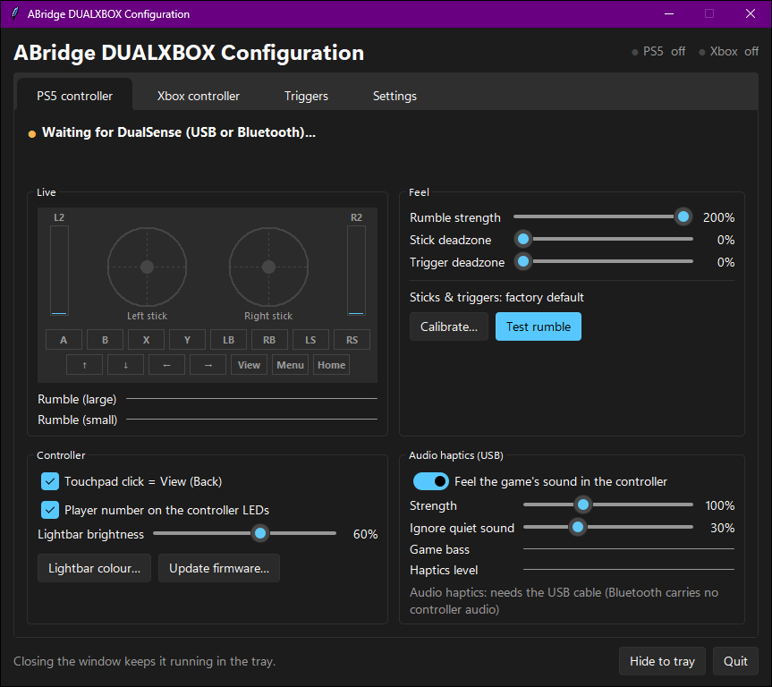
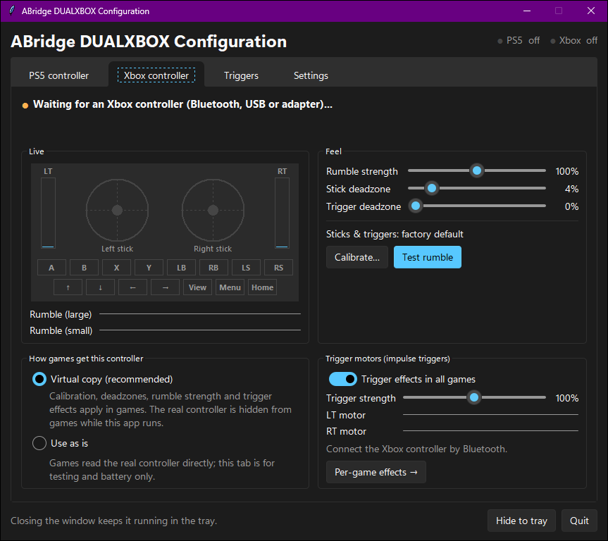
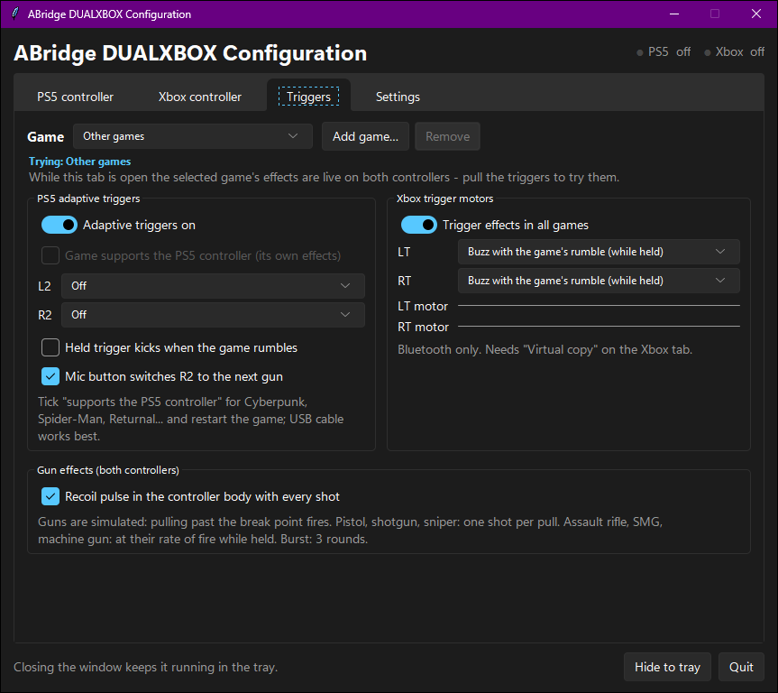
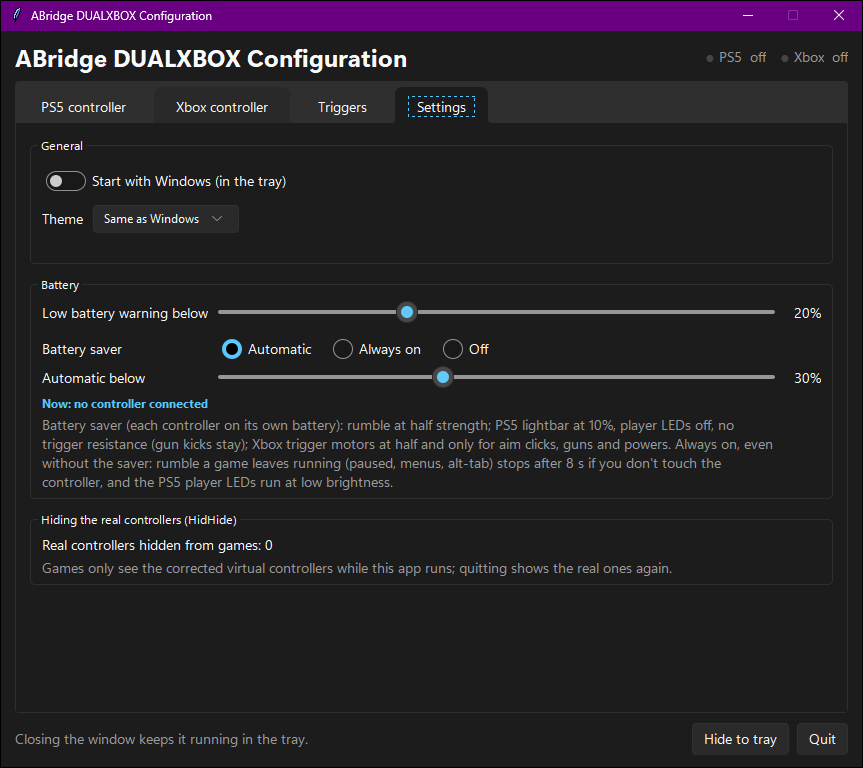

# ABridge DUALXBOX Configuration

A free Windows companion app for **PS5 DualSense** and **Xbox Series / One** controllers on PC.

- **DualSense → Xbox:** every game sees your DualSense as a normal Xbox controller, with rumble, **adaptive triggers** and **audio haptics**.
- **Xbox controller:** games get a calibrated virtual copy, plus **impulse-trigger (trigger motor) effects in every game**, even games that never supported them.
- **Per-game profiles**, simulated **gun triggers**, **battery saver**, and about **0.25 ms** added input delay.



## Features

### PS5 DualSense / DualSense Edge (USB or Bluetooth)
- Shows up as a virtual **Xbox 360 controller** (ViGEmBus), so every game with Xbox controller support works, Steam or not.
- **Rumble** from games, 0–200% strength.
- **Adaptive triggers per game** on L2/R2: off, light or heavy resistance, gun "click", machine-gun rattle.
- **Simulated guns**: pistol, assault rifle, burst, SMG, machine gun, shotgun and sniper. Pulling past the break point fires, the trigger kicks at the gun's rate of fire, with an optional recoil pulse in the controller body. The **mic button** switches to the next gun.
- **Native PS5 games** (Cyberpunk 2077, Spider-Man, Returnal…): tick *"Game supports the PS5 controller"* and the app hands the real DualSense to that game, so you get the game's own triggers and haptics.
- **Audio haptics (USB):** feel the game's sound through the haptic motors, with a noise gate so quiet music and ambience aren't felt, and live bass/level meters.
- **Touchpad click = View (Back)**, lightbar colour and brightness, player-number LEDs.
- **Calibration wizard** for sticks and triggers, stick and trigger deadzones.
- **Firmware updater shortcut** (Sony's official tool).
- Live view of sticks, triggers, buttons and rumble.

### Xbox controller (Series X|S, One, Elite; Bluetooth for trigger motors)
- **Virtual copy** mode: games get a corrected copy with your calibration, deadzones and rumble strength; the real pad is hidden from games.
- **Trigger motors in all games**, sent straight to the controller over Bluetooth. Per game, LT and RT can each be:
  - **Buzz with the game's rumble** while you hold the trigger
  - **Aim:** a soft click when you pull past halfway, then buzz with the game's rumble
  - **Guns:** the same seven presets as the DualSense
  - **Powers:** e.g. *boulder launch*, a launch thump followed by the game's own power surge, boosted
  - **Machine-gun rattle** or **off**
- Trigger strength 0–100%, live LT/RT motor meters, battery level read from Windows.
- Turning the controller off and on, or Windows moving it to another slot, is handled automatically.



### Per-game profiles (both controllers)
- Games are detected when they start; each game remembers its own PS5 trigger effects and Xbox trigger-motor effects, plus "Other games" as the default.
- While the **Triggers** tab is open the selected profile is **live**, so you can pull the triggers and feel it before playing.



### Battery and comfort
- Low-battery warning in the tray (repeats every 15 min while low).
- **Battery saver:** automatic below a chosen %, always on, or off. Half-strength rumble, dim lightbar, LEDs off, only short trigger effects.
- **Stuck rumble stop:** rumble a game leaves running (pause menus, alt-tab) stops after 8 s if you aren't touching the controller.
- Windows 11 style UI with light/dark theme, tray icon, **Start with Windows**.

### HidHide integration
- While the app runs, games only see the virtual controllers, so there's **no double input**. Quitting the app shows the real controllers again.
- The app registers itself with HidHide automatically; nothing to set up by hand.



## Requirements (install these first)

| What | Why | Where |
| --- | --- | --- |
| **Windows 10 or 11, 64-bit** | | |
| **Python 3.12 (64-bit)** | runs the app. Tick **"Add python.exe to PATH"** in the installer | [python.org/downloads](https://www.python.org/downloads/) |
| **ViGEmBus** (required) | creates the virtual Xbox controllers | [ViGEmBus releases](https://github.com/nefarius/ViGEmBus/releases) |
| **HidHide** (strongly recommended) | hides the real controllers from games, so they don't see two pads. **Restart the PC** after installing | [HidHide releases](https://github.com/nefarius/HidHide/releases) |
| **Bluetooth** | Xbox trigger motors only work over Bluetooth. Over USB or the Xbox Wireless Adapter you get normal rumble only | |
| **USB cable** (DualSense) | needed for audio haptics; Bluetooth works for everything else | |

## Install

1. Install the requirements above (Python, ViGEmBus, HidHide), then restart the PC.
2. Download the zip from [Releases](https://github.com/R1tom/ABridge-DUALXBOX/releases/latest) and extract it somewhere permanent (for example `D:\Apps\ABridge`).
3. Double-click **`install.bat`**. It checks the drivers, creates a private Python environment, installs the dependencies, adds Desktop and Start menu shortcuts and opens the app.
4. In the app's **Settings** tab, turn on **Start with Windows** if you want it in the tray at logon.

Manual install instead of `install.bat`:
```bat
py -3.12 -m venv venv
venv\Scripts\pip install -r requirements.txt
venv\Scripts\pythonw.exe ps5toxbox.pyw
```
`--minimized` starts the app in the tray, and `--tab N` (0–3) opens it on a given tab. Settings are saved in `config.json` next to the app.

## Set up Windows, Steam and other tools (important)

Other software that also grabs the controller causes double input, wrong buttons or no trigger effects. Check these once:

- **Close other controller tools:** DS4Windows, DualSenseX (DSX), reWASD, x360ce, InputMapper. Don't run them together with this app.
- **Steam Input:** Steam can take over the controller and remap it.
  - Steam → Settings → Controller: turn **off** Steam Input for **PlayStation** and **Xbox** controllers (the names of these switches differ a little between Steam versions).
  - For a Steam game that still misbehaves: right-click the game → Properties → Controller → **"Disable Steam Input"**.
  - Steam → Settings → Controller → **"Guide Button Focuses Steam"**: turn it off, or the PS / Xbox button opens Steam over your game.
- **Xbox Game Bar:** Settings → Gaming → Game Bar → turn **off** *"Open Game Bar using this button on a controller"*, so the PS / Xbox button doesn't pop up Game Bar mid-game.
- **Native PS5 games** (Cyberpunk 2077, Spider-Man, Returnal, Ratchet & Clank, God of War…): add the game on the Triggers tab and tick *"Game supports the PS5 controller"*, then restart the game. The game then talks to the DualSense itself; a USB cable gives the best haptics.
- **Xbox controller firmware:** update it with the **Xbox Accessories** app from the Microsoft Store. Older Xbox One controllers without Bluetooth can't use trigger motors on PC.
- **DualSense firmware:** use *Update firmware…* on the PS5 controller tab (Sony's official updater). The app releases the controller while it updates.
- **Anti-cheat games:** a few competitive games block virtual controllers. Use *"Use as is"* on the Xbox tab, or quit the app, for those.

## Troubleshooting

- **"Could not create the virtual Xbox controller"**: ViGEmBus isn't installed or needs a restart.
- **Games see two controllers / double input**: HidHide isn't installed, or the PC wasn't restarted after installing it. The Settings tab shows how many real controllers are hidden.
- **No Xbox trigger effects**: connect the controller over Bluetooth, select *Virtual copy* on the Xbox tab, and make sure the game's profile isn't set to *off*.
- **No audio haptics**: they need the DualSense on a USB cable.
- Problems are logged to `abridge.log` (connects, disconnects, recovered errors) and `abridge_crash.log` next to the app.

## Latency
The input path does only three things: read the controller, apply calibration, update the virtual pad. Rumble, trigger effects, guns and battery checks run on other threads. Measured on an i5-11400F for the Xbox copy:
- Polls every **0.50 ms** (median; 99th percentile 0.57 ms)
- Forwarding takes **0.02 ms**

That's about **0.25 ms** added on average. The DualSense side is event-driven: it forwards each report as soon as it arrives.

## Reliability
- **Self-healing bridges:** if a controller bridge hits an unexpected error, the app logs it and restarts the bridge about 1 s later. You don't need to restart the app or the PC.
- **Turning the Xbox controller off and on** is handled. Windows can put the controller back in a different XInput slot, so the app checks 4 times a second that it's still reading the real controller and finds it again if it moved. Each check takes about 4 µs and runs outside the input path.
- **Crash log:** a crash inside a native library (for example ViGEmClient) is written to `abridge_crash.log`.

## Works with KILA Local Game Library
[KILA Local Game Library](https://github.com/R1tom/kila-local-game-library) has an in-game overlay opened with the PS / Xbox button. With both apps running, the overlay can read the controller while games get a neutral pad, and keeps the Guide button for itself (`overlay_link.py`, a 16-byte shared-memory block). Without the overlay this does nothing.

## Notes
- Windows.Gaming.Input ignores vibration from background apps, and XInput has no trigger motors. That's why the Xbox trigger effects are written as Bluetooth HID output report `0x03` (`[mask, LT, RT, strong, weak, on-time, off-time, repeat]`).
- Not affiliated with Sony or Microsoft. DualSense, PlayStation and Xbox are trademarks of their owners.

## Changelog
**1.1.0** (2026-10-20)
- Renamed from PadBridge to **ABridge DUALXBOX Configuration**. Logs are now `abridge.log` / `abridge_crash.log`.
- New `install.bat`: checks ViGEmBus and HidHide, sets up Python and adds shortcuts.
- README: full requirements and Windows / Steam setup guide.

**1.0.0** (2026-10-18)
- Fixed: the Xbox controller stopped working after it was turned off and on. The app kept reading its own virtual pad, and the Xbox tab showed "USB powered" instead of the battery level.
- Fixed: a crash about 1 s after start when no DualSense was connected. Virtual pads were freed while ViGEm was still using them. They are now removed safely.
- HidHide rules are re-applied only when something changes, not every 30 s.
- Added the optional game-overlay link.
- The controller bridges recover from unexpected errors on their own and log the cause.

## License
[MIT](LICENSE)
